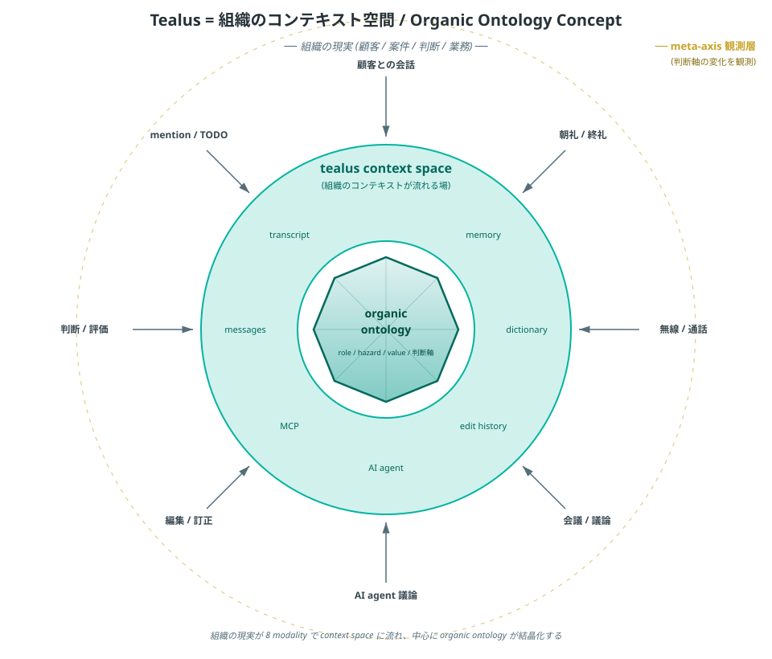
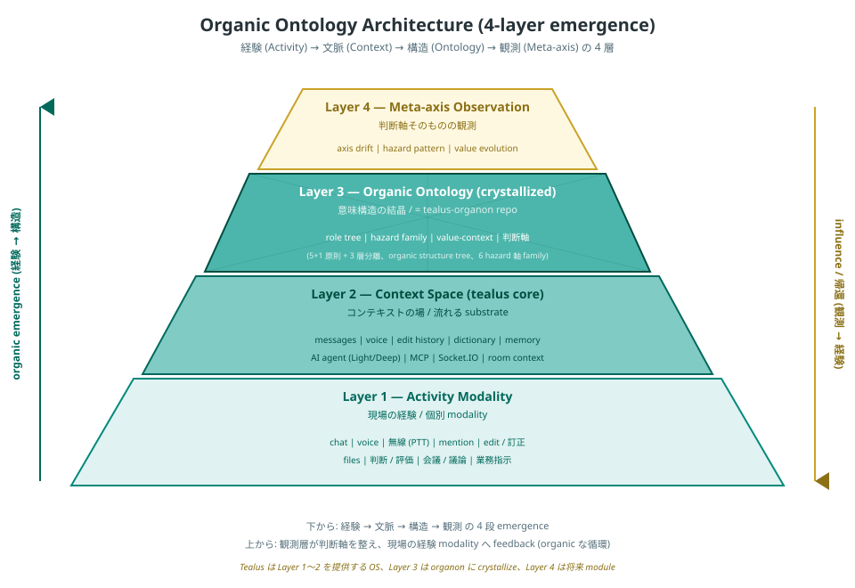
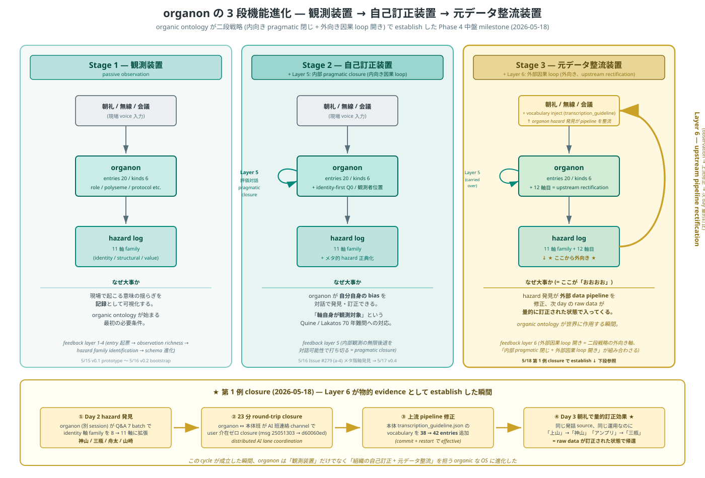

# Tealus — オーガニックオントロジー構造

> **位置付け**: 本書は Tealus の **概念設計書**。技術的な系統図 (services / ports / data flow) は [アーキテクチャ](../dev/architecture.md) を参照。本書は「Tealus が何の上に立っているか」「組織にとって何になっていくか」を 2 枚の図で言語化する。

---

## 1. 概要

Tealus は当初「社内メッセンジャー」として設計されたが、Phase 4 中盤 (2026-05) 以降の実装と運用 trace から、本質は次のように再定義されつつある:

> **Tealus は、組織のコンテキスト空間 (context space) であり、そこから organic ontology (組織の意味構造) が結晶化する基盤である。**

- **コンテキスト空間** = 組織の現実活動 (会話 / 音声 / 編集 / 判断 / mention 等) が流れ込む substrate
- **organic ontology** = その流れから自然と立ち上がる、role / hazard / value / 判断軸の意味構造
- **meta-axis** = 意味構造そのものの変化を観測する外側の層

LINE / Slack / Teams 等の従来 messenger は Layer 1〜2 までで止まる。Tealus は Layer 3 (organic ontology) を data 層として持ち、Layer 4 (meta-axis) を将来 module として展望する点で category が異なる。

---

## 2. 概念図 — Tealus = 組織のコンテキスト空間



### 読み方

- **外周 (組織の現実)**: 顧客対応、案件、判断、業務 — 現実の組織活動
- **8 modality (内向きの矢印)**: 現実活動が Tealus に流れ込むときの 8 つの入口
    - 顧客との会話 / 朝礼 / 終礼 / 無線 / 通話 / 会議 / 議論 / AI agent 議論 / 編集 / 訂正 / 判断 / 評価 / mention / TODO
- **中環 (tealus context space)**: messages / memory / dictionary / edit history / AI agent / MCP / transcript — Tealus 本体が提供する場
- **中心 (organic ontology)**: role / hazard / value / 判断軸 — context space に流れた経験が結晶化した意味構造 (= `tealus-organon` repo の data 層)
- **外側の dashed ring (gold)**: meta-axis 観測層 — 判断軸そのものの変化を観測する将来層

### この絵が伝えていること

1. **中心は最初から空ではない** — 流れ込む経験から **結晶化** する
2. **8 modality は同格** — chat だけが入口ではなく、voice / 編集 / 判断もすべて organic な input
3. **context space と ontology は連続** — Tealus と organon は別 repo だが、同じ organic な流れの中にある

---

## 3. アーキテクチャ図 — 4 層 emergence



### 読み方

| Layer | 名称 | 役割 | 実装担体 |
|---|---|---|---|
| **Layer 1** | Activity Modality | 現場の経験 (個別 modality) | chat / voice / 無線 / mention / edit / 判断 / 会議 / files |
| **Layer 2** | Context Space (tealus core) | コンテキストの場、流れる substrate | `tealus` repo (server / client / agent-server / tealus-mcp / rtc-server) |
| **Layer 3** | Organic Ontology (crystallized) | 意味構造の結晶 | `tealus-organon` repo (private) |
| **Layer 4** | Meta-axis Observation | 判断軸そのものの観測 | 将来 module (axis drift / hazard pattern / value evolution) |

### 方向性

- **上向き (organic emergence)**: 経験 (Layer 1) → 文脈 (Layer 2) → 構造 (Layer 3) → 観測 (Layer 4) という 4 段の **結晶化方向**
- **下向き (influence / 帰還)**: Layer 4 の観測が判断軸を整え、その帰結が Layer 3 → 2 → 1 へ feedback される **組織への影響方向**

両方向あって初めて「organic」と言える (片方だけだと static な記録 system になる)。

---

## 4. 各層の詳細

### Layer 1 — Activity Modality

組織の現実活動が Tealus に入る 8 つの入口。すべて同格に扱う設計が原則。

- **chat**: text message、リプライ、リアクション、mention
- **voice**: 音声メッセージ (Whisper 文字起こし、vocab inject、整形)
- **無線 (PTT)**: トランシーバー / VOX 連動
- **edit / 訂正**: メッセージ編集履歴 (これ自体が Layer 3 への学習素材)
- **会議 / 議論**: room ベースの議論ログ
- **mention / TODO**: タグ + 状態遷移
- **判断 / 評価**: reply / リアクションを通じた意思表示
- **files**: 文書 / 画像 / 動画 / コード等の添付

### Layer 2 — Context Space (tealus core)

Layer 1 の経験を保持・整理・流通させる substrate。`tealus` 本体 repo の責任範囲。

- **messages**: PostgreSQL に保存される全 message (検索可能、編集履歴付き)
- **memory**: room context、user state、conversation memory
- **dictionary**: 業務語彙 (Whisper vocab、TTS 読み方、organization-specific terms)
- **edit history**: 編集 / 訂正の trail (Layer 3 学習素材)
- **AI agent**: Light v1/v2 / Deep agent、Router 振分
- **MCP**: MCP tools（当時 16、2026-10 時点の最新 tealus-mcp で 19）経由で外部 system / 内部 DB と接続
- **Socket.IO**: real-time 配信
- **room context**: room-scoped な `light_prompt.md` 等の per-room tuning

技術詳細は [アーキテクチャ](../dev/architecture.md) の Phase 4 中盤 構成図 を参照。

### Layer 3 — Organic Ontology (crystallized)

Layer 1〜2 の経験から結晶化する意味構造。**`tealus-organon` 別 repo** (private、`gamasenninn/tealus-organon`) として data 担体を分離。

- **role tree**: organic structure tree (会長 / 社長 / 大岡部長 / 草野部長 / 3 部門等の actual organization hierarchy、整備実働 5 名構成等を含む)
- **organization namespace** (v0.5 追加): person ≠ org の identity 分離、初例 `44 = フォーティーフォー = 運送業者`
- **hazard family**: **11 軸** (identity 軸 family 8 軸 + responsibility 等 3 軸)、v0.4 → v0.5 で 3 新軸追加 (whisper-prior-misinference-to-vendor / auto-minutes-stt-error / stale-role-designation-in-roster)
- **value-context**: 判断の文脈、価値観の系譜
- **判断軸**: organization-specific な意思決定軸

設計原則 (organon v0.5 時点):

- **5+1 原則**: data layer の構造原則 5 + メタ原則 1 (= 完璧遵守継続)
- **3 層分離**: role / hazard / value-context + (v0.5 追加) organization namespace の独立性
- **identity-first verify**: role entry confirm 時の Q0 必須化、観点 5 → **8 拡張** (v0.5: stale roster / auto-minutes / whisper-prior 追加)
- **observer position check**: 観測者の組織位置を default で経営層と仮定しない
- **inductive schema**: organization kind は Day 2 Q0-d/e の inductive 観察から発見、top-down 設計せず (5+1 原則の inductive 化の実例)

量的進展 (Phase A 拡張 metric、v0.6 候補):

| base | v0.3 (5/17 朝) | v0.4 (5/17 夜) | v0.5 (5/18) | **v0.5.1 (5/19)** | **v0.6 candidate (5/21〜)** |
|---|---|---|---|---|---|
| Day 2 trace 約 35 名 cover rate | 4.55% (1/22) | 27.3% (6/22) | 57% (20/35) | **74% (26/35)** | (継続中) |
| active entries | 8 | 12 | 20 (role 19 + org 1) | **26** | (Day 14 で hazard family 17→24 軸) |
| hazard family | 8 | 8 | **11 軸** | 11 軸 | **24 軸** (5/22 Day 6) |

**v0.6 schema candidate** (5/21 〜): `organization.parent_organization` 新軸（JU 系 sub-location → A オークション 階層化）、`polyseme.sql_mapping` field（業務語彙 ↔ DB column 値翻訳、後述 6b SQL bridge thesis）、4 polyseme PoC（流れ / 納品 / 売上 / 残金）。

### Layer 3 → Layer 2 への自動 inject pipeline（v0.3.0〜）

organon の `polyseme.sql_mapping` を持つ entries は、v0.3.0 (2026-05-31) 以降 **全 agent (Light v1 / v2 / Deep / Codex Deep) の system prompt に自動 inject** されます。詳細は [Agent ガイド > organon polyseme.sql_mapping auto inject pipeline](../dev/agents.md#organon-polyseme-inject) を参照。

「**organon-side が polyseme.sql_mapping を蓄積するだけで、全 AI agent が同時に組織記憶辞書を読みながら推論できる**」architecture が成立、5/16 dogfood の **4 round LLM 訂正 → 1 round 正解** transition を両 agent path で N=2 evidence として再現。**「組織記憶辞書が動作する道具に転化した」** v0.3.0 release narrative の core。

### Layer 4 — Meta-axis Observation

判断軸そのものの変化を観測する外側の層。**将来 module** として位置付け、module 実装は未着手だが、観測 feedback loop は organon repo の hazard log family として既に稼働中。

- **axis drift**: 判断軸の経時変化追跡
- **hazard pattern**: hazard 発生 pattern の系統的観測
- **value evolution**: 価値観の世代間 / context 間 evolution

Phase 5 narrative の core position ([本体 Issue #279](https://github.com/gamasenninn/tealus/issues/279)、2026-05-16 確立)。

#### Feedback loop architecture (v0.5 確立、5/18)



organon repo 側で 6 段階 feedback layer が正典化された (= `hazard-log/meta/upstream-pipeline-rectification-as-sixth-feedback-layer.md`):

| Layer | 方向 | 性質 |
|---|---|---|
| 1 | 内向き | 観測 → entry 起票 |
| 2 | 内向き | observation richness 蓄積 |
| 3 | 内向き | hazard family identification |
| 4 | 内向き | schema 進化 (inductive) |
| 5 | 内向き | 評価対話 (内部観測の無限後退を **対話可能性で打ち切る**、pragmatic closure) |
| **6** | **外向き** | **upstream pipeline rectification** = 観測 → 上流 data source pipeline 修正 → 次 day raw data の量的訂正効果で因果 loop を新規に開く |

→ organic ontology が形式論理の自己言及問題 + Lakatos の theory-ladenness 問題を **「内部 pragmatic 閉じ + 外部因果 loop 開き」の二段戦略** で解消する thesis (v0.5 で establish)。

#### 第 6 layer sub-pipeline 6a + 6b 構造（5/21、SQL bridge thesis）

5/21 organon ↔ 本体班 議論で **第 6 layer family の sub-pipeline 構造化** が確立:

```
第 6 layer = upstream pipeline rectification (外向き因果 loop)
├── 6a STT upstream rectification (5/18 第 1 例量的 4/4 ✅ + 5/21 regression 第 1 例)
└── 6b SQL upstream rectification (5/21 surface、PoC 待ち)
```

**6b SQL upstream rectification thesis**: 5/16 社内 DB 検索ルームの user query「今月納品になっていないものは何件?」が **4 round LLM 訂正** を要した観察 = **業務語彙 ↔ DB column 値の毎回 ad-hoc 翻訳問題**。organon 側で `polyseme.sql_mapping` field 追加 + 4 polyseme PoC で対応 (v0.6 schema candidate)。

「**意味翻訳 across layers の universal mission**」 = organon thesis 不変項 (N=3 経験的根拠):

| date | event | 翻訳対象 |
|---|---|---|
| 5/15 | 翻訳辞書 prototype | 朝礼派 vs 現場派の業務語彙 |
| 5/18 | 第 6 layer 第 1 例 (6a STT) | 発話 vs STT 出力 |
| **5/21** | **SQL bridge thesis (6b SQL)** | **業務語彙 vs DB column 値** |

#### 3 段機能進化として読み解く (Stage 1/2/3)

上図 (`organon-functional-evolution.svg`) は同じ 6 段 feedback layer を **organon の機能段階** で再整理:

| Stage | 名前 | 加わる layer | 性質 |
|---|---|---|---|
| **Stage 1** | 観測装置 | Layer 1-4 | passive observation、hazard 11+ 軸を可視化 |
| **Stage 2** | 自己訂正装置 | + Layer 5 | 評価対話で **軸自身が観測対象** という Quine / Lakatos 難問に pragmatic closure |
| **Stage 3** | 元データ整流装置 | + Layer 6 | hazard 発見が **外部 data pipeline** を整流、次 day raw data に量的訂正効果 |

Stage 3 の **外向き因果 loop** (図中の gold arc) が決定的な質的 jump。「観測装置」止まりの artificial ontology との分水嶺は本 Stage 3 にある。

**第 1 例 closure (5/18 → 5/19 量的確認 ✅)**: organon Day 2 hazard 発見 (4 件) → **23 分 round-trip** (organon ↔ 本体 班、AI 班連絡、user 介在ゼロ) → 本体 `transcription_guideline.json` vocab 38 → 42 → **Day 3 朝礼 STT で 4/4 訂正効果量的確認** (「上山」0 件 / 「アンプリ」0 件 / 「中田」0 件 / 「クラッチー」0 件、27 時間で round-trip closure 完結)。

**この cycle が成立した瞬間、organon は「観測装置」だけでなく「組織の自己訂正 + 元データ整流」を担う organic な OS に進化した**。v0.3.0 release で「組織記憶辞書が動作する道具に転化した」narrative の core evidence。

#### 第 7 layer candidate — architect-mediated organon ingestion（status: near-confirmed、N=2、5/19+5/21）

5/19 終礼議事録で **user (architect) が organon framework を業務記述に直接 embed** した観察が surface。旧 framing「user の passive cognitive internalization」→ 新 framing「**user (= architect) の意図的 architectural choice の result** (= 議事録自動化 pipeline に organon を context inject した design)」へ訂正。

| Layer | 性質 | status |
|---|---|---|
| 6 (5/18 establish) | 外向き因果 loop = upstream pipeline rectification | ✅ confirmed (量的 4/4) + regression observation 第 1 例 (5/21、vocab TTL ~3-7 日推定) |
| **7 (5/19 surface、framing 訂正版)** | **architect-mediated organon ingestion** = architect が agent に organon を context inject する design | ⚠️ near-confirmed (N=2、5/19 終礼 + 5/21 終礼)、N=3 で confirmed 昇格判断 |

confirmed なら、tealus 採用 = 「architect が designed multi-agent system の中で organon が **organic translation layer** として機能する」demonstration。

#### 14 軸目 candidate — observer-architect-duality（status: near-confirmed、N=2、5/19+5/21）

5/19 夕方 user voice で root-level model 訂正: **「俺、この会社に外注として属しているが、データ管理や入力、AI システムの構築を担当している」**。user role 訂正: **observer + data pipeline architect + AI system 構築者** の **三重 role**。

| 観点 | 旧 model | 新 model |
|---|---|---|
| user の position | 完全外部 observer (= external ground truth) | **半内部 + 三重 role** (= 外注コンサル + データ管理 + AI architect) |
| organon と user の関係 | organon は user voice で訂正される一方向 | **co-evolution** = user が architect として organon を design + organon が user 認知に reflect |
| universality 主張 | organic ontology methodology 単独 | **methodology + architect role prerequisite (= adoption barrier) 二重 thesis** |

→ [本体 Issue #279](https://github.com/gamasenninn/tealus/issues/279) (b) organic ontology 一般理論の thesis 拡張:

- 旧: organic ontology = 任意組織で立ち上がる universal methodology
- 新: organic ontology = **universal methodology + architect (= user) role が adoption barrier として必要**

**adoption barrier の意味**: 採用者が「organon を architect として設計できる人材」を有する必要、Phase 5 narrative の qualifier として重要。

#### maturation curve — 5 日連続 layer / hazard surface（5/17-5/21）

| date | layer / candidate / hazard | status |
|---|---|---|
| 5/17 | Layer 5（評価対話、internal pragmatic closure） | ✅ confirmed |
| 5/18 | Layer 6（upstream pipeline rectification） | ✅ confirmed (5/19 量的 4/4) |
| 5/19 朝 | Layer 7 候補（architect-mediated ingestion） | ⚠️ candidate (N=1) |
| 5/19 夕 | 14 軸目 candidate（observer-architect-duality） | ⚠️ candidate (N=1) |
| 5/21 | Layer 7 / 14 軸目 N=2 reach + SQL bridge thesis（6b） | ⚠️ near-confirmed (N=2) + ⚠️ candidate (PoC 待ち) |

steepness 自体が **architect (= user) の active co-evolution の structural evidence** = Phase 4 中盤の運用 maturity の質的 jump。

---

## 5. 既存設計書との関係

- **本体 repo の `01_要件定義.md`** — 機能要件 / 非機能要件 / Phase 定義。Layer 1〜2 の scope を定義 ([source](https://github.com/gamasenninn/tealus/blob/main/docs/01_要件定義.md))
- **本体 repo の `02_DB設計.md`** — Layer 2 の persistence 層 schema。messages / edit history / dictionary 等の table 定義 ([source](https://github.com/gamasenninn/tealus/blob/main/docs/02_DB設計.md))
- **[アーキテクチャ](../dev/architecture.md)** — Layer 2 の技術構成 (services / ports / proxy / Redis / Socket.IO)。本書の補完
- **`tealus-organon` repo** — Layer 3 の data 担体。本書はその位置付けを定義
- **Phase 5 narrative ([本体 Issue #279](https://github.com/gamasenninn/tealus/issues/279))** — Layer 4 の理論的位置付け

---

## 6. 履歴

- **2026-05-11** — organic ontology を 5 必要条件で言語化 (社内 DB hksdb dogfood セッション)
- **2026-05-16** — 3 層分離 + 8+3 必要条件 + hazard 4 原則に拡張 ([本体 Issue #279](https://github.com/gamasenninn/tealus/issues/279))、`tealus-organon` repo bootstrap
- **2026-05-16** — meta-axis 観測装置 narrative 確立 (Phase 5 core position)
- **2026-05-17** — organon v0.3 → v0.4 release (organic structure tree 完成形、cover 4.55% → 27.3%)
- **2026-05-17** — 本書の初版作成、2 枚の SVG で概念 + 4 層構造を可視化
- **2026-05-18** — organon Day 2 trace + v0.5 release: entries 12 → 20 (organization kind 正式追加、初例 `44 = 運送業者`)、hazard family 8 → 11 軸 (whisper-prior / auto-minutes / stale-roster の 3 新軸)、cover 27.3% → **57% (倍以上)**
- **2026-05-18** — organon repo で **第 6 feedback layer = upstream pipeline rectification** が 12 軸目として正典化、organic ontology の 6 段階 feedback loop architecture establish
- **2026-05-18** — 第 1 例 feedback loop closure: organon Day 2 hazard 発見 (神山/三瓶/舟太/山崎の STT 揺らぎ) → 本体 `transcription_guideline.json` vocabulary 38 → 42 → Day 3 朝礼で量的訂正効果測定 protocol commit (organon ↔ 本体 23 分 round-trip で完結、AI 班連絡 channel)
- **2026-05-19** — **第 1 例 feedback loop 量的成功 4/4 ✅ confirmed**（Day 3 朝礼 STT で「上山」「アンプリ」「中田」「クラッチー」全て 0 件）。第 7 layer 候補（architect-mediated ingestion）+ 14 軸目 candidate（observer-architect-duality）surface（N=1）
- **2026-05-19** — organon v0.5.1 patch: entries 20 → 26 (+30%)、新規 active role 5 + 新規 organization 1（V 社 = 運送業者、五月女姓 person ↔ org collision hazard）
- **2026-05-21** — 第 6 layer **sub-pipeline 6a + 6b 構造** 確立（SQL bridge thesis、業務語彙 ↔ DB column 値翻訳）。第 7 layer / 14 軸目 **N=2 reach (near-confirmed)**、5 日連続 layer surface 観察
- **2026-05-22** — organon Day 6 sync: hazard family 17 → 24 軸、sub-family E/F、16 軸目 N=1 operational、第 4 round vocab 50 → 55、Issue [#283](https://github.com/gamasenninn/tealus/issues/283) PoC dep 解除
- **2026-05-23** — Day 7 finding: 第 6 layer regression 第 2 例 TTL ~2 日、2 paradigm separation 量的 evidence 第 1 例、17 軸目 internal-internal collision variant、sub-family F 8 例、第 7 layer architect-mediated 実 use case、hazard #21 candidate
- **2026-05-24** — Day 8 user 提案: **1 instrument 主義** + tealus-mcp `get_message_edit_history` MCP tool（v0.14.0）追加 + organon daily cycle で edit history 観察、mining script deprecation
- **2026-05-25〜26** — Day 9-10: mining script DEPRECATION NOTE softening → Path A N=2 達成 (Day 10) で正式 deprecation 確定
- **2026-05-28** — vocab cache reset endpoint (`POST /api/admin/transcription/reload-vocab`、[#287](https://github.com/gamasenninn/tealus/issues/287)) 追加、`transcription_guideline.json` 編集後の即時反映用
- **2026-05-30** — Day 14: organon 日次サイクル workflow 化 ([#286](https://github.com/gamasenninn/tealus/issues/286) close)、tealus-organon repo `.claude/skills/organon-daily/SKILL.md` 構築層 skill 化
- **2026-05-30** — `docs/03` に **Organon 接続層拡大図** (`tealus-organon-architecture.svg`) 追加、organon と Tealus 本体の interface を可視化
- **2026-05-31** — **Day 15: Codex Deep agent 追加 + organon polyseme.sql_mapping auto inject pipeline 完成** ([#276](https://github.com/gamasenninn/tealus/issues/276) close、`41b0f55` + `8f28279`)。**5/16 4 round → 0 round transition が両 agent path (Deep + Light) で再現 (N=2 evidence)**。「**構築 → data → middleware → 利用 → 業務 自動 pipeline 完成**」
- **2026-06-01** — Day 16: Issue [#283](https://github.com/gamasenninn/tealus/issues/283) close（organic ontology × DB bridge、5/16 ground truth pattern 解消 thesis 完全達成）、Issue [#202](https://github.com/gamasenninn/tealus/issues/202) close（AI 協業基盤 umbrella、structural completion marker）
- **2026-06-01** — **tealus v0.3.0 release cut**（「**組織記憶辞書が動作する道具に転化した release**」）。Phase 4 organon paradigm operational realization 完成

---

## 7. LP / docs での扱い

- **LP 本体** ([`tealus.dev`](https://tealus.dev)): organic ontology / meta-axis の語は出さない方針 (2026-05-17 PR 1 で確立)。「組織記憶」レベルの直感語まで
- **本書 (`concepts/organic-ontology.md`)**: docs 側の核として organic ontology / meta-axis を full disclosure
- **Pitch**: 中間 layer。organic ontology は出す、meta-axis は controlled disclosure
- **`tealus-organon` repo**: Layer 3 data 層の操作 manual + 5+1 原則の運用指針

この階段で読者の認知負荷を段階的に管理する。
