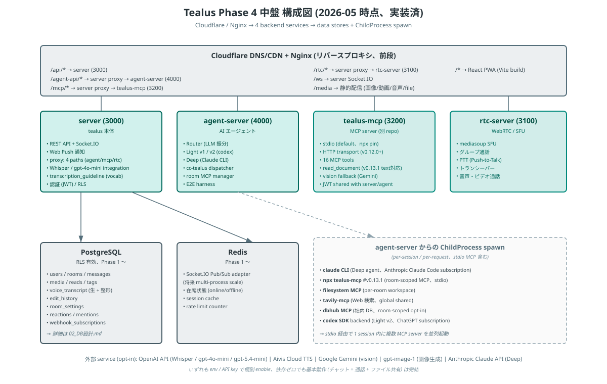
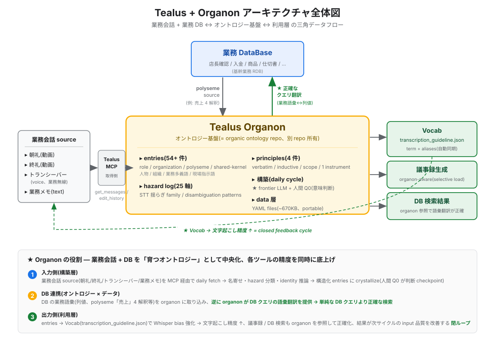

# アーキテクチャ

## システム全体構成 — Phase 4 中盤



Phase 4 中盤 (2026-05) の構成図。Light v1 / Light v2 (codex SDK backed) / Deep agent の 3 tier、cc-tealus bridge、HTTP transport (cross-machine 構成、`/mcp` proxy) を含む完成 phase。詳細な component 説明は本 page 以降を参照。

!!! note "図は 2026-05 時点のスナップショットです"
    サービス構成そのものは現在も同じですが、図中の細部にはその後変わったものがあります。**MCP ツールは 18**（[MCP Server](mcp.md)）、**コードは全レイヤー TypeScript 化**され `.mts` を直接実行する構成（下記「実行モデル」）、**画像生成は `gpt-image-1`** です。

## Tealus ↔ organon 接続層（v0.3.0〜）



v0.3.0 (2026-06-01) で **organon polyseme.sql_mapping auto inject pipeline** が追加され、Tealus 本体と [tealus-organon](https://github.com/gamasenninn/tealus-organon) repo（Layer 3 data 担体、private）の **間接接続** が標準化されました（[#276](https://github.com/gamasenninn/tealus/issues/276) follow-up、本体 commit `8f28279`）。

- 接続方式: `agent-server/src/lib/organonContext.mts` が **per-request `fs.readFileSync`** で organon repo の polyseme entries を読み込み、system prompt に inject（v0.7.0 [#349](https://github.com/gamasenninn/tealus/issues/349) から `sql_mapping` ブロックのみに限定）
- 双方向同期: 必要なし。organon-side が entries を蓄積するだけで全 agent が自動反映（agent-server restart 不要）
- env: ★ **`ORGANON_INJECT=true`（default OFF の opt-in、[#304](https://github.com/gamasenninn/tealus/issues/304)）** / `ORGANON_REPO_PATH` で path override / 不在時は稼働継続 + 起動ログに WARN（[#347](https://github.com/gamasenninn/tealus/issues/347)）
    - 旧 `INJECT_ORGANON_POLYSEME`（default ON）は**廃止・fallback 無し**。詳細は [Agent ガイド](agents.md#organon-polyseme-inject) を参照

詳細な architecture は [organic ontology 概念設計](../concepts/organic-ontology.md) を参照。Codex Deep agent + Light v1/v2 すべての agent path で **5/16 4 round → 0 round transition** が N=2 evidence として再現された **「組織記憶辞書が動作する道具に転化した」** v0.3.0 release narrative の core 技術構成です。

!!! info "RTC Server はオプショナル"
    RTC Server は **通話機能** および **TTS の legacy 配信経路**（`TTS_BROADCAST_MEDIASOUP=true`）で利用されます。default の TTS 配信は Socket.IO blob 経由のため、TTS のみ利用するなら RTC Server なしで動作します。Mac / Windows ホスト含めた幅広い環境で立ち上げやすくなりました。

### 詳細 ASCII reference

SVG 図の構造を grep 可能な形で残した詳細 reference (基本 service 構成、port、proxy 関係):

```
┌─────────────────────────────────────────────────┐
│                   クライアント                     │
│         React 19 + Vite + PWA + Zustand          │
│              http://localhost:5173                │
└───────────────┬─────────────────┬────────────────┘
                │ REST API        │ WebSocket
                │ /api/*          │ /socket.io
                ▼                 ▼
┌─────────────────────────────────────────────────┐
│                 Tealus Server                    │
│          Node.js + Express + Socket.IO           │
│              http://localhost:3000                │
│                                                  │
│  ┌──────────┐ ┌──────────┐ ┌──────────────────┐ │
│  │ Routes   │ │ Socket   │ │ Middleware       │ │
│  │ (REST)   │ │ Handlers │ │ (Auth/Upload)    │ │
│  └────┬─────┘ └────┬─────┘ └──────────────────┘ │
│       │             │                            │
│  ┌────▼─────────────▼────┐  ┌─────────────────┐ │
│  │     PostgreSQL 16     │  │    Redis 7       │ │
│  │      (RLS有効)        │  │  (セッション/    │ │
│  │     :5432             │  │   在席管理)      │ │
│  └───────────────────────┘  └─────────────────┘ │
└──────────┬──────────────────────┬────────────────┘
           │ Webhook              │ Proxy（通話 / TTS legacy / /mcp HTTP transport）
           ▼                      ▼
┌──────────────────┐   ┌──────────────────────────┐
│  Agent Server    │   │  RTC Server (オプショナル) │
│  (AI エージェント) │   │  (mediasoup SFU)          │
│  :4000           │   │  :3100                     │
└──────────────────┘   └──────────────────────────┘
```

## 実行モデル — TypeScript のまま実行する（v0.5.0〜）

v0.5.0（[#330](https://github.com/gamasenninn/tealus/issues/330)）で全レイヤーが TypeScript 化されました。**サーバー系にビルド工程はありません。**

| レイヤー | 拡張子 | 実行 / 配信 |
|---|---|---|
| server / agent-server / rtc-server | `.mts` | **ビルドせず直接実行**（`node src/app.mts`）。Node の native type stripping が型注釈を落としながら実行します |
| client / dashboard | `.ts` / `.tsx` | `vite build` で `dist/` を生成し、server が静的配信 |
| CLI（`scripts/`） | `.ts` | `node scripts/tealus-cli.ts` で直接実行 |

この構成には 2 つの帰結があります。

- **Node 24 が必須**です。型注釈をそのまま解釈できない版では起動しません（[サーバー構築 > 前提条件](../admin/server-setup.md)）
- **型検査は実行時に行われません。** `tsc --noEmit` を別工程（`npm run typecheck`、CI の各ジョブ）で回します。型エラーがあってもサーバー自体は起動しうる、という点に注意してください

!!! info "更新時の注意"
    サーバー系はビルド不要ですが、**client / dashboard は `npm run build` が必要**です。再ビルドを忘れると古い画面が配信され続けます（v0.7.0 では、これが原因で更新検知そのものが入らない、という事故が起きます）。起動時の `[build-check]` ログで成果物の有無を確認できます。

!!! warning "★ PWA 更新検知を触るときの地雷"
    更新検知（[#356](https://github.com/gamasenninn/tealus/issues/356)）は、ビルド時に生成される `dist/version.json` と、バンドルに焼き込まれた同じ ID を突き合わせて判定します。

    **`vite.config.js` の `globIgnores` から `version.json` を外すと、更新検知が黙って死にます。** precache 対象に入ってしまうと常に古い ID が返るためです。エラーにはならず、バナーが出なくなるだけなので気づけません。同様に `/api/*` が precache 対象外かつ navigateFallback の除外に入っていることも、検知が成立する前提条件です。

## コンポーネント構成

### フロントエンド（client/）

| ディレクトリ | 役割 |
|---|---|
| `components/auth/` | ログイン画面 |
| `components/home/` | ホーム画面 |
| `components/room-list/` | トーク一覧・ルーム作成 |
| `components/chat/` | チャット本体（吹き出し・入力・設定・メンバー一覧） |
| `components/call/` | 通話UI（mediasoup） |
| `components/media/` | 画像グリッド・ビューア・ギャラリー |
| `components/admin/` | 管理者ダッシュボード |
| `components/multi/` | マルチトーク（複数ルーム並列） |
| `components/search/` | 全文検索 |
| `components/stamp/` | AIスタンプ生成・送信 |
| `components/share/` | PWA Share Target |
| `hooks/` | カスタムフック（Socket同期・通話・スクロール等） |
| `stores/` | Zustand状態管理（auth・message・room） |
| `services/` | API/Socket.IO/Pushクライアント |

### バックエンド（server/）

| ディレクトリ | 役割 |
|---|---|
| `routes/` | REST APIルート定義（19 ファイル ＋ `routes/admin/` 9 ファイル） |
| `socket/handlers/` | Socket.IOイベントハンドラ（message・read・typing・call） |
| `middleware/` | JWT認証・ファイルアップロード |
| `services/` | プッシュ通知・サムネイル生成等のビジネスロジック |
| `db/` | DB接続・マイグレーション（001〜040、台帳 `schema_migrations`） |
| `utils/` | ユーティリティ |

### AIエージェント（agent-server/）

| ディレクトリ | 役割 |
|---|---|
| `agents/` | Light/Deep エージェント実装 |
| `webhook/` | Webhookディスパッチャー・ハンドラ |
| `mcp/` | MCPマネージャー |
| `context/` | セッション・設定マネージャー |
| `memory/` | ファイルベースメモリ |

## データベース設計

### コアテーブル

| テーブル | 役割 |
|---|---|
| `users` | ユーザー（ユーザーID・表示名・アバター・ロール） |
| `rooms` | トークルーム（direct/group） |
| `room_members` | ルーム参加者（ロール: admin/member） |
| `messages` | メッセージ（テキスト・画像・動画・音声・スタンプ・システム） |
| `message_media` | 添付ファイル（ファイルパス・MIME・サムネイル） |
| `room_read_cursors` | 既読カーソル（一覧用の未読数管理） |
| `message_reads` | 既読記録（チャット画面の既読数表示） |
| `push_subscriptions` | プッシュ通知購読 |

### 拡張テーブル

| テーブル | 役割 |
|---|---|
| `voice_transcriptions` | 音声文字起こし（OpenAI 文字起こし API 連携、default `gpt-4o-mini-transcribe`、env `WHISPER_MODEL` で切替可） |
| `tags` / `message_tags` | タグ・TODO機能 |
| `stamp_packs` / `stamps` | AIスタンプ |
| `webhooks` | Webhook設定 |
| `agent_contexts` | AIエージェントセッション |

### Row Level Security（RLS）

`messages`、`room_members`、`message_reads` テーブルにRLSが有効です。`current_setting('app.current_user_id', true)` でユーザーを識別し、自分が参加しているルームのデータのみアクセス可能です。

## 認証フロー

```
POST /api/auth/login { login_id, password }
    ↓ bcryptで検証
JWT発行（ペイロード: user_id, role）
    ↓
Authorization: Bearer <token>
    ↓ middleware/auth.mts で検証
req.user にユーザー情報を設定
```

Socket.IO接続時も `handshake.auth.token` でJWTを検証します。

## TTS 音声合成パイプライン

AIエージェントの回答を音声で読み上げる経路には **default（Socket.IO blob）** と **legacy（mediasoup PlainTransport）** の 2 種類があります。default は rtc-server なしで動作するため、Mac / Windows を含む全プラットフォームでセットアップが容易です。

### default 経路: Socket.IO blob 配信

環境変数 `TTS_BROADCAST_MEDIASOUP` が未設定または `false` のときの default 経路です（[#189](https://github.com/gamasenninn/tealus/issues/189)）。

```
agent-server: speakMessage(roomId, text)
  → テキスト前処理（Markdown除去・URL省略・500文字制限）
  → Aivis Cloud API (HTTPS POST) → WAV バイナリ
  → server (HTTP) に WAV をPOST
      └── Socket.IO emit `tts:audio` (binary blob, room broadcast)
          → 各 client が <audio> 要素で再生
              └── Web Audio API GainNode で音量補正（1.0 超のブースト可能）
```

| メリット | 内容 |
|---|---|
| rtc-server 不要 | Mac / Windows ホストでも追加サービスなしで動作 |
| ホスト制約なし | mediasoup の C++ 拡張ビルドが不要 |
| 実装が単純 | Socket.IO の binary 送信機能をそのまま利用 |
| 音量補正が柔軟 | Web Audio API GainNode で `<audio>.volume` の上限 1.0 を超える音量に対応（[#198](https://github.com/gamasenninn/tealus/issues/198)） |

### legacy 経路: mediasoup PlainTransport

環境変数 `TTS_BROADCAST_MEDIASOUP=true` を設定したとき、または既存運用との互換性が必要な場合に利用します。mediasoup の **PlainTransport** で WebRTC スタックなしに音声を注入する経路です。

```
agent-server: speakMessage(roomId, text)
  → テキスト前処理（Markdown除去・URL省略・500文字制限）
  → Aivis Cloud API (HTTPS POST) → WAV バイナリ
  → sendViaPlainTransport(wavFile, roomId)
      ├── WebSocket → rtc-server (localhost:3100)
      ├── join → createPlainTransport(comedia: true)
      ├── plainProduce(ssrc: 1111)
      ├── Consumer セットアップ待ち 2秒
      └── ffmpeg → Opus RTP → PlainTransport → Router
          → WebRTC Consumer → ブラウザで再生
```

#### PlainTransport の仕組み

通常の WebRTC 通話では、ブラウザ間で DTLS/SRTP を使った暗号化通信を行います。一方 PlainTransport は **暗号化なしの RTP/RTCP を直接受け取る**トランスポートで、サーバーサイドの音声ソース（ffmpeg 等）から mediasoup に音声を注入する用途に適しています。

**comedia モード**: 送信元の IP:port を事前に指定する代わりに、最初の RTP パケットから自動検知します。ローカルホスト内の通信で利用しています。

#### ffmpeg パラメータ

```bash
ffmpeg -re -i <wavFile> \
  -af adelay=300|300,apad=pad_dur=500ms \
  -c:a libopus -ac 2 -ar 48000 -b:a 32k \
  -f rtp -ssrc 1111 -payload_type 100 \
  rtp://127.0.0.1:<port>
```

| パラメータ | 値 | 説明 |
|---|---|---|
| `-re` | — | リアルタイム速度で送信 |
| `adelay=300\|300` | 300ms | 頭切れ防止の先頭無音 |
| `apad=pad_dur=500ms` | 500ms | 尻切れ防止の末尾無音 |
| `-c:a libopus` | Opus | コーデック |
| `-ar 48000` | 48kHz | サンプリングレート |
| `-b:a 32k` | 32kbps | ビットレート |
| `-ssrc 1111` | 固定値 | RTP ストリーム識別子 |
| `-payload_type 100` | 100 | mediasoup と合わせた PT 番号 |

### 経路の選択

| 状況 | 推奨経路 |
|---|---|
| 新規導入 / Mac / Windows / Docker で簡素化したい | **default**（Socket.IO blob） |
| 既存の mediasoup 運用と互換性を維持したい | legacy（`TTS_BROADCAST_MEDIASOUP=true`） |
| 通話機能と音声 mixing を共通インフラで処理したい | legacy |
